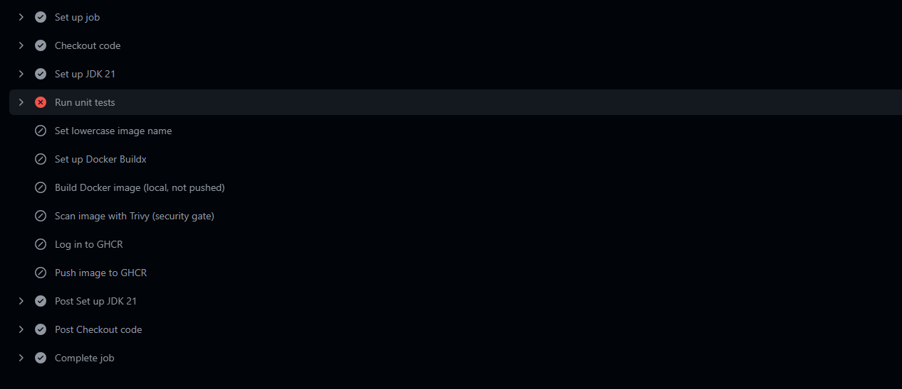
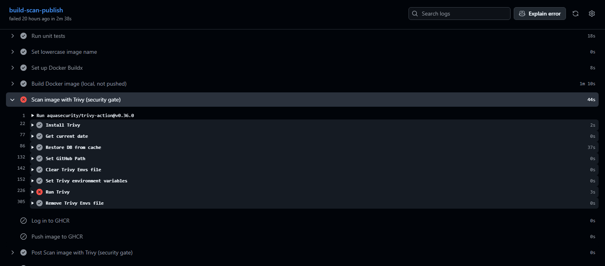
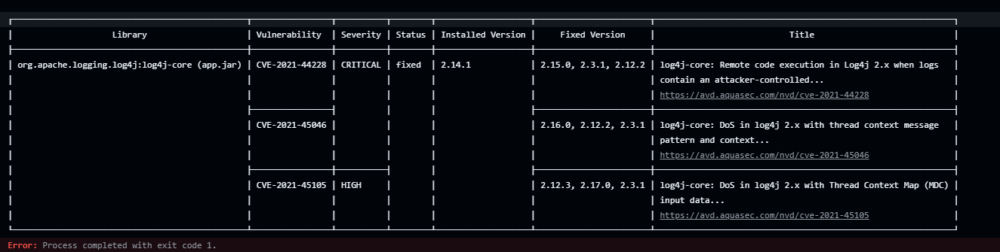
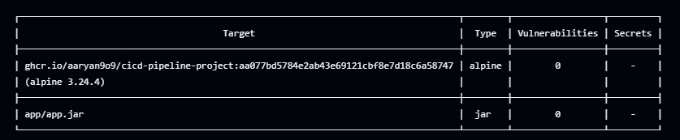

# Automated CI/CD Pipeline with GitHub Actions, Docker and Trivy


An end-to-end CI/CD pipeline for a Spring Boot service. On every commit, 
GitHub Actions runs the unit tests, builds a Docker image, scans it with Trivy, 
and publishes it to GitHub Container Registry (GHCR)
**only if** the scan finds no fixable HIGH or CRITICAL vulnerabilities.

The application is intentionally tiny. The pipeline is the project.

## Pipeline flow

```
git push
   |
   v
Unit tests (Maven) ---- fail ----> pipeline stops
   |
   v
Build Docker image (local, not pushed)
   |
   v
Trivy scan (HIGH / CRITICAL) ---- CVEs found ----> pipeline stops, nothing published
   |
   v
Log in to GHCR  -->  Push image (tagged with commit SHA and latest)
```

Pull requests run the tests, build and scan, but never publish. Publishing only happens on pushes to `main`.

## Tech stack

| Area | Tool |
|---|---|
| Application | Java 21, Spring Boot (Web, Actuator) |
| Build and test | Maven, JUnit 5, MockMvc |
| Containerisation | Docker (multi-stage build, non-root user) |
| CI/CD | GitHub Actions |
| Security scanning | Trivy (`aquasecurity/trivy-action`) |
| Registry | GitHub Container Registry (GHCR) |

## Key design decisions

- **Scan before publish.** The image is built with `load: true`, so it exists only on the runner.
- Trivy scans it there, and the push step comes afterwards. A vulnerable image never reaches the registry.
- **Trivy as a hard gate.** `severity: HIGH,CRITICAL` with `exit-code: '1'` makes the step fail, which skips every step after it.
- **`ignore-unfixed: true`.** CVEs with no available patch are skipped, since they can't be acted on. Remove this for stricter scanning.
- **Multi-stage Dockerfile.** The JDK and Maven stay in the build stage. The final image has only a JRE and the jar, so it is smaller and has fewer packages to be vulnerable.
- **Layer ordering.** `pom.xml` and dependencies are copied before the source, so Docker reuses the cached dependency layer.
- **Non-root container user.** The app runs as an unprivileged `spring` user (least privilege).
- **Least-privilege workflow permissions.** The workflow requests only `contents: read` and `packages: write`, and authenticates to GHCR with the short-lived built-in `GITHUB_TOKEN`, so no stored password or personal access token is needed.
- **Traceable tags.** Every image is tagged with the commit SHA. `latest` is a convenience tag only.

## Proof that the gates work

I deliberately broke each gate to confirm the pipeline blocks bad changes.

### 1. Test gate

A test assertion was changed to fail. The run stopped at **Run unit tests**, and the Docker build, Trivy scan and push were skipped.



### 2. Security gate

An old, vulnerable `log4j-core` (2.14.1, affected by CVE-2021-44228) was added as a dependency.
Tests and the Docker build passed, but **Trivy failed the build** and the push to GHCR was skipped.





Both changes were then reverted, the scan came back clean, and the image was published:



## Run the published image

```bash
docker pull ghcr.io/aaryan9o9/cicd-pipeline-project:latest
docker run -p 8080:8080 ghcr.io/aaryan9o9/cicd-pipeline-project:latest
```

Then open `http://localhost:8080/hello?name=Aaryan` or `http://localhost:8080/actuator/health`.

## Run it locally

```bash
./mvnw clean verify
docker build -t cicd-demo .
docker run -p 8080:8080 cicd-demo
```

## Limitations and next steps

- The pipeline publishes an image but does not deploy it. A next step is a deploy job with approvals, for example to AWS ECS or Kubernetes.
- Trivy detects known CVEs only. It does not replace SAST, secret scanning or dependency review.
- Third-party actions are referenced by version tag. Pinning them to commit SHAs would protect against tag hijacking, which affected `trivy-action` in March 2026.
- Possible additions: Dependabot, uploading Trivy results to the GitHub Security tab (SARIF), image signing with Cosign, and branch protection that requires the pipeline to pass.